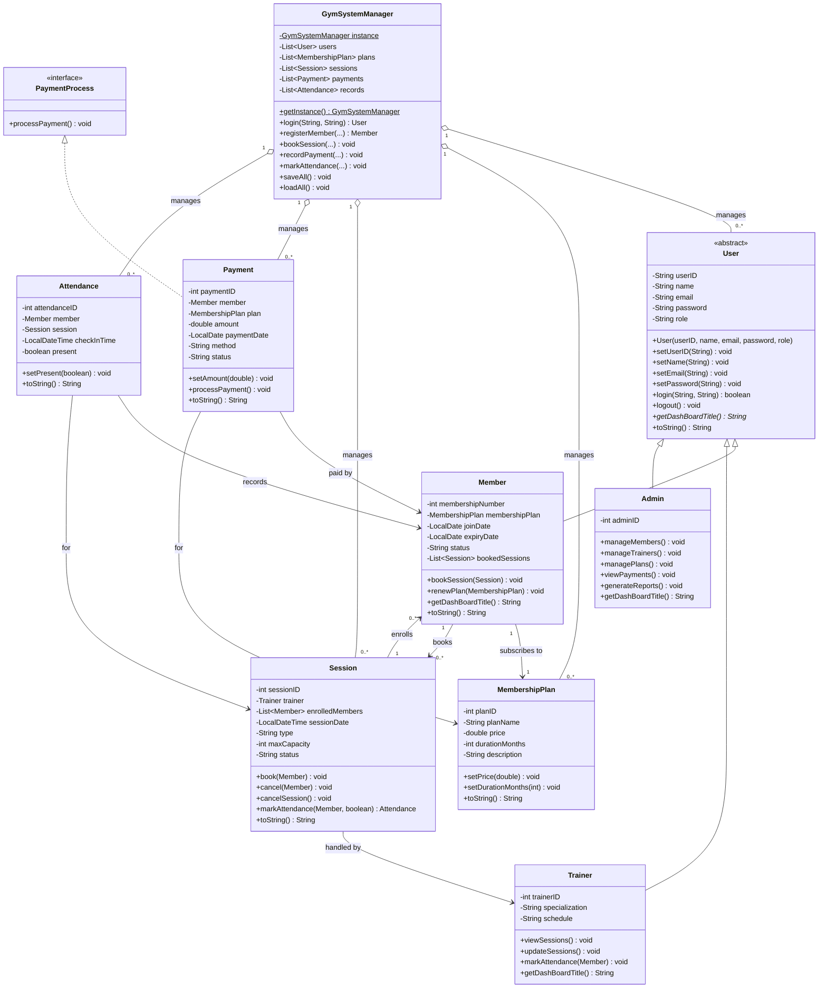

<div align="center">

# Gym Membership System
**Cebu Institute of Technology – University**

**CSIT227 | Object-Oriented Programming | Capstone Project**

**BSCS-2 (Group C)**

</div>

---

## Group Members

- **Ecarma, Kirsten Van B.**
- **Gabito, Khian F.**
- **Palang, Javen Shane C.**
- **Villarba, Neil Allen A.**
- **Zarate, James Philip Rex T.**

---

## Project Overview

The **Gym Membership System** is a Java-based desktop application featuring a Graphical User Interface (GUI) built to automate and streamline gym operations. Through this application, gym members can register for membership plans, book training sessions, and process payments, while trainers can manage their schedules and track attendance. Administrators have full oversight to manage users, membership plans, payments, and system reports.

The system is designed around the four core pillars of Object-Oriented Programming (OOP), supplemented by exception handling, file handling, and interactive GUI components.

### Implementation Status (as of the current commit)

| Module | Status |
|---|---|
| `models` package - `User`, `Member`, `Trainer`, `Admin`, `MembershipPlan`, `PaymentProcess`, `Payment`, `Session`, `Attendance` |  Implemented |
| `ui.LoginForm` (+ `LoginForm.form`) |  Implemented - validates input and checks credentials |
| `models.GymSystemManager` (Singleton + CSV persistence) |  Planned - design fully specified in Sections 2, 3.2 and 3.4 |
| `ui.RegisterForm`, `ui.MemberDashboard`, `ui.TrainerDashboard`, `ui.AdminDashboard` |  Planned - layouts and behavior specified in Sections 1.4 and 3.3 |

> Everything marked  is documented here as the agreed design so the class diagram and rubric items stay accurate; the code for it is the remaining sprint work.

---

## Table of Contents

1. [The Four Pillars of OOP](#1-the-four-pillars-of-oop)
2. [Core System Classes & Relationships](#2-core-system-classes--relationships)
3. [Additional Technical Implementation](#3-additional-technical-implementation)
4. [Design Patterns](#4-design-patterns)
5. [How to Run](#5-how-to-run)
6. [Demo Login Credentials](#6-demo-login-credentials)
7. [Project Structure](#7-project-structure)

---

## 1. The Four Pillars of OOP

### 1.1 Abstraction (Abstract Classes & Interfaces)

Abstraction hides implementation detail and exposes only the behavior each part of the system needs to know about.

| Where | Evidence in code |
|---|---|
| `models.User` | Declared as `public abstract class User`. It defines the shared identity of every account (`userID`, `name`, `email`, `password`, `role`) plus the contract `public abstract String getDashBoardTitle();` - every subclass **must** supply its own dashboard title, so no code in the system ever has to guess what a `User` is. |
| `models.PaymentProcess` | `public interface PaymentProcess { void processPayment() throws Exception; }`. `models.Payment implements PaymentProcess`, so the rest of the system can trigger `processPayment()` on any payment object without knowing how the payment is settled (cash, card, e-wallet). |

**Effect:** `MemberDashboard`, `TrainerDashboard`, and `AdminDashboard` call `user.getDashBoardTitle()` without knowing which concrete subclass they received, and any class can call `processPayment()` on a `PaymentProcess` reference.

---

### 1.2 Inheritance

`models.Member`, `models.Trainer`, and `models.Admin` all **extend** the abstract `models.User`.

```
                User  (abstract)
                  ^
      ┌───────────┼───────────┐
   Member      Trainer      Admin
```

Each subclass calls `super(userId, name, email, password, "<Role>")` in its constructor, so field validation and the login/logout behavior are written **once** in `User` and reused by all three roles:

| Subclass | Extra fields | Role passed to `super()` |
|---|---|---|
| `Member` | `membershipNumber`, `membershipPlan`, `joinDate`, `expiryDate`, `status`, `bookedSessions` | `"Member"` |
| `Trainer` | `trainerID`, `specialization`, `schedule` | `"Trainer"` |
| `Admin` | `adminID` | `"Admin"` |

`models.Attendance` and `models.Payment` also use composition (`Attendance` holds a `Member` and a `Session`; `Payment` holds a `Member` and a `MembershipPlan`), which keeps the model layer reusable and free of duplicated fields.

---

### 1.3 Encapsulation

All fields in every model class are **`private`**, and every write goes through a **setter that validates** before assigning:

| Class | Private fields | Validated setter(s) |
|---|---|---|
| `User` | `userID`, `name`, `email`, `password`, `role` | `setUserID()` enforces the `XX-XXXX-XXX` format via `matches("\\d{2}-\\d{4}-\\d{3}")`; `setName()` rejects empty names; `setEmail()` requires `@`; `setPassword()` requires at least 4 characters. |
| `MembershipPlan` | `planID`, `planName`, `price`, `durationMonths`, `description` | `setPrice()` throws if the price is negative; `setDurationMonths()` throws if the duration is 0 or below. |
| `Payment` | `paymentID`, `member`, `plan`, `amount`, `paymentDate`, `method`, `status` | `setAmount()` throws if the amount is `<= 0`. |
| `Member` | `membershipNumber`, `membershipPlan`, `joinDate`, `expiryDate`, `status`, `bookedSessions` | `bookSession()` throws `IllegalStateException` when the account is not `"Active"`; `renewPlan()` recalculates `expiryDate` from the later of today or the current expiry. |
| `Session` | `sessionID`, `trainer`, `enrolledMembers`, `sessionDate`, `type`, `maxCapacity`, `status` | `book()` throws if the session is `"Cancelled"` or already at `maxCapacity`. |
| `Attendance` | `attendanceID`, `member`, `session`, `checkInTime`, `present` | `setPresent()` is the only mutator; the timestamp is captured internally at construction. |

Because the fields are private, an object can never be placed in an invalid state from the outside, e.g. `new MembershipPlan(1, "Gold", -500, 0, "...")` fails immediately instead of corrupting the plan list.

---

### 1.4 Polymorphism

Polymorphism is demonstrated through **method overriding** on `getDashBoardTitle()` and `toString()`:

```java
// User.java (abstract contract)
public abstract String getDashBoardTitle();

// Member.java
@Override
public String getDashBoardTitle() { return "Member Portal - " + getName(); }

// Trainer.java
@Override
public String getDashBoardTitle() { return "Trainer Portal - " + getName() + " (" + specialization + ")"; }

// Admin.java
@Override
public String getDashBoardTitle() { return "Admin Control Panel - " + getName(); }
```

Calling `user.getDashBoardTitle()` on a `User` reference executes the **subclass's** version at runtime, so a single line in a dashboard window personalizes itself for whoever logged in:

- `Member.toString()` → `Juan Dela Cruz (#1001 - Active)`
- `User.toString()` → `[Member] Juan Dela Cruz (member@gym.com)`
- `MembershipPlan.toString()` → `Gold (₱1500.00 / 1 mo)`
- `Session.toString()` → `Strength (3/10) - 2026-11-20T08:00`
- `Attendance.toString()` → `Juan Dela Cruz | Strength | Present | 2026-11-20T08:12`

`LoginForm` also routes by runtime type (`instanceof`) once the dashboard screens are wired in:

```java
if (matchedUser instanceof Member member)        { new MemberDashboard(member).setVisible(true); }
else if (matchedUser instanceof Trainer trainer) { new TrainerDashboard(trainer).setVisible(true); }
else if (matchedUser instanceof Admin admin)     { new AdminDashboard(admin).setVisible(true); }
```

---

## 2. Core System Classes & Relationships

### 2.1 Class Diagram



> `GymSystemManager` is the planned central registry (Singleton). `Session`, `Attendance`, `Payment` and `MembershipPlan` are already coded; the manager and the four remaining screens are the pending modules — they are kept in the diagram so the class diagram stays accurate for the rubric.

### 2.2 Relationship Summary

| Relationship | Type | Classes | Why |
|---|---|---|---|
| Generalization | Inheritance | `User` → `Member`, `Trainer`, `Admin` | All accounts share identity, login and dashboard contract. |
| Realization | Interface implementation | `PaymentProcess` → `Payment` | Payment behavior is abstracted; `Payment` supplies `processPayment()`. |
| Association | One-to-one | `Member` → `MembershipPlan` | A member currently holds exactly one active plan. |
| Association | One-to-many | `Session` → `Member` (`enrolledMembers`) | A session holds the list of enrolled members, capped by `maxCapacity`. |
| Association | One-to-many | `Member` → `Session` (`bookedSessions`) | A member keeps their own list of booked sessions. |
| Association | One-to-many | `Trainer` → `Session` | Each session is handled by one trainer. |
| Association | Many-to-many (resolved) | `Member` ↔ `Session` | Linked through both lists plus `Attendance`. |
| Association | One-to-many | `Member`/`Session` → `Attendance` | Attendance is the join record with a `checkInTime` and `present` flag. |
| Aggregation / Registry | Singleton manager | `GymSystemManager` → all models | One central object owns the in-memory collections and persists them to CSV. |

---

## 3. Additional Technical Implementation

### 3.1 Exception Handling

The system relies on **three complementary layers** of exception handling:

**1) Custom validation using built-in unchecked exceptions.** Every setter guards its own invariants:

```java
// User.java
public void setUserID(String userID) {
    if (userID == null || !userID.trim().matches("\\d{2}-\\d{4}-\\d{3}")) {
        throw new IllegalArgumentException("User ID must follow the format XX-XXXX-XXX (e.g., 25-1824-135).");
    }
    this.userID = userID.trim();
}

// MembershipPlan.java
public void setPrice(double price) {
    if (price < 0) throw new IllegalArgumentException("Plan price cannot be negative.");
    this.price = price;
}

// Member.java - business rule, not a format problem
public void bookSession(Session session) {
    if (!"Active".equalsIgnoreCase(status)) {
        throw new IllegalStateException("Cannot book session: membership is " + status);
    }
    bookedSessions.add(session);
}

// Session.java - capacity rule
public void book(Member member) {
    if ("Cancelled".equalsIgnoreCase(status)) throw new IllegalStateException("Cannot book a cancelled session.");
    if (enrolledMembers.size() >= maxCapacity)  throw new IllegalStateException("Session is already full.");
    ...
}
```

**2) `throws` on the interface.** `PaymentProcess.processPayment()` declares `throws Exception`, which forces every caller (the GUI and `GymSystemManager`) to acknowledge that a payment can fail:

```java
public interface PaymentProcess {
    void processPayment() throws Exception;
}
```

**3) GUI-level catching and user feedback.** Actions are wrapped in `try-catch`, and the message is shown back to the user through the shared dialog helper instead of crashing the window:

```java
try {
    payment.processPayment();
    showMessageDialog(this, "Payment completed. Receipt No. " + payment.getPaymentID());
} catch (IllegalArgumentException ex) {
    showMessageDialog(this, "Payment failed: " + ex.getMessage());   // e.g. insufficient amount
} catch (Exception ex) {
    showMessageDialog(this, "Unexpected error: " + ex.getMessage());
}
```

`LoginForm` already reports problems without exceptions crossing the UI boundary:

```java
if (!userID.matches("\\d{2}-\\d{4}-\\d{3}")) {
    JOptionPane.showMessageDialog(this,
        "Invalid User ID format. Use XX-XXXX-XXX (e.g., 25-1824-135).",
        "Invalid Format", JOptionPane.WARNING_MESSAGE);
    return;
}
```

### 3.2 File Handling (CSV Persistence)

*(Persistence layer is planned - the CSV schema below is the specification the file-handling methods will implement.)*

All records are persisted as plain **CSV text files** inside the `data/` folder, written and read by `GymSystemManager` using `BufferedReader` / `BufferedWriter` (`java.io`). No external database is required, so the project runs offline on any machine with a JDK.

```
data/
├── users.csv
├── trainers.csv
├── members_table.csv
├── plans.csv
├── payments.csv
├── sessions.csv
└── attendance.csv
```

**CSV structure:**

| File | Header (row 1) | Sample row |
|---|---|---|
| `users.csv` | `userID,name,email,password,role` | `25-1824-135,System Admin,admin@gym.com,admin123,Admin` |
| `trainers.csv` | `userID,trainerID,specialization,schedule` | `25-1231-123,201,Strength,MWF 8AM-5PM` |
| `members_table.csv` | `userID,membershipNumber,planID,joinDate,expiryDate,status` | `25-1231-124,1001,1,2026-11-20,2026-12-20,Active` |
| `plans.csv` | `planID,planName,price,durationMonths,description` | `1,Gold,1500.00,1,Full gym + classes` |
| `payments.csv` | `paymentID,userID,planID,amount,paymentDate,method,status` | `5001,25-1231-124,1,1500.00,2026-11-20,Cash,Completed` |
| `sessions.csv` | `sessionID,trainerID,type,sessionDate,maxCapacity,status,enrolledUserIDs` | `301,201,Strength,2026-11-22T08:00,10,Scheduled,25-1231-124;25-1232-118` |
| `attendance.csv` | `attendanceID,userID,sessionID,checkInTime,present` | `701,25-1231-124,301,2026-11-22T08:12,true` |

**Conventions**

- Dates use `LocalDate.toString()` (`yyyy-MM-dd`); timestamps use `LocalDateTime.toString()` (`yyyy-MM-ddTHH:mm`), so both parse back with `LocalDate.parse()` / `LocalDateTime.parse()`.
- Multi-value cells (`enrolledUserIDs`) are joined with `;` to stay inside one CSV field.
- On startup `loadAll()` reads each file into the in-memory lists; `saveAll()` rewrites the file after every add/update/delete (register, book, pay, mark attendance).
- Reading is defensive: a missing file is treated as an empty list (`new File(...).exists()` check) and malformed rows are skipped with a warning instead of stopping the program.

### 3.3 GUI Screens

The GUI is built with **Java Swing**, designed in the IntelliJ GUI Designer (`.form` files) and bound to panels declared in the Java classes.

| Screen | Class | Purpose |
|---|---|---|
| **Login** | `ui.LoginForm` | `JTextField` for User ID, `JPasswordField` for password, `Login` / `Register` buttons. Validates the `XX-XXXX-XXX` format, checks credentials through `User.login()`, clears the password on failure, then opens the matching dashboard. |
| **Register** | `ui.RegisterForm` | Registers a new Member (Name, User ID, Email, Password, choose a `MembershipPlan`), processes the initial payment, writes to file, and returns to `LoginForm`. |
| **Member Dashboard** | `ui.MemberDashboard` | Displays `member.getDashBoardTitle()`, current plan & expiry date, and buttons/tabs to Book Session, Renew Plan / Pay, View Attendance, and Logout. |
| **Trainer Dashboard** | `ui.TrainerDashboard` | Displays `trainer.getDashBoardTitle()`, specialization & schedule, the list of sessions, and a button to Mark Member Attendance (saves to file) + Logout. |
| **Admin Dashboard** | `ui.AdminDashboard` | Displays `admin.getDashBoardTitle()` with tabbed tables to Manage Members, Manage Trainers, Manage Plans, View Payments, and Generate Summary Report + Logout. |

**Shared dialog helpers** keep the screens consistent:

- `showMessageDialog(...)` - registration success, payment receipt, booking confirmation, and caught error messages.
- `showConfirmDialog(...)` - confirm Logout, confirm Cancel Session, confirm Delete Member/Plan.
- `showInputDialog(...)` *(optional)* - quick input for payment amount or adding a plan/session.

### 3.4 Design Pattern - Singleton

*(Planned module - the class below is the agreed design.)*

`GymSystemManager` uses the **Singleton** pattern so that exactly one object owns the application data; every screen reads and writes the same lists instead of passing collections around.

```java
public class GymSystemManager {
    private static GymSystemManager instance;      // single shared instance

    private GymSystemManager() {                   // private constructor
        users = new ArrayList<>();
        plans = new ArrayList<>();
        sessions = new ArrayList<>();
        payments = new ArrayList<>();
        attendanceRecords = new ArrayList<>();
    }

    public static GymSystemManager getInstance() { // global access point
        if (instance == null) instance = new GymSystemManager();
        return instance;
    }
    // ... loadAll(), saveAll(), registerMember(), bookSession(), recordPayment() ...
}
```

**Why it fits here:** the CSV files (`users.csv`, `payments.csv`, `attendance.csv`, …) must have exactly one writer. With a single instance, two dashboards can never hold divergent copies of the member list, and concurrent "save" calls from different screens cannot overwrite each other's changes.

---

## 4. How to Run

### Requirements

- **JDK 17 or higher** (`java -version` to check) - used for `instanceof` pattern matching.
- IntelliJ IDEA (recommended, for the GUI Designer `.form` files) or any IDE/terminal with `javac`.
- No database, no external libraries - pure Java SE (`Swing`, `java.time`, `java.io`).

### Option A - IntelliJ IDEA

1. `File → Open` and select the project folder.
2. Make sure the `src` folder is marked as **Sources Root** and the package layout is preserved (`models/`, `ui/`).
3. Keep each `.form` file **beside** its `.java` class (`ui/LoginForm.form` next to `ui/LoginForm.java`) so the GUI Designer can regenerate the `$$$setupUI$$$` code.
4. Right-click `ui/LoginForm` → **Run 'LoginForm.main()'**.

### Option B - Command line

```bash
# from the project root
javac -d out $(find src -name "*.java")
java -cp out ui.LoginForm
```

> **Note:** the `data/` folder must exist in the working directory before the first run (or `GymSystemManager` will create it on startup).

### First-run checklist

1. Launch the app → the **Login** window appears.
2. Log in as **Admin** to verify member/trainer/plan tables, then generate a summary report.
3. Log out, log in as **Trainer**, and mark attendance for a session.
4. Log out, log in as **Member**, book a session, then renew the plan and confirm the new expiry date.
5. Close and relaunch to confirm the CSV files were written and reloaded correctly.

---

## 5. Demo Login Credentials

Pre-loaded accounts (`LoginForm.loadDummyUsers()`), so the professor can test every screen immediately without registering:

| Role | User ID | Password | Loaded record |
|---|---|---|---|
| **Admin** | `25-1824-135` | `admin123` | System Admin (adminID `101`) |
| **Trainer** | `25-1231-123` | `train123` | Coach Alex - Strength, MWF 8AM-5PM (trainerID `201`) |
| **Member** | `25-1231-124` | `mem123` | Juan Dela Cruz, #1001, Gold plan (₱1,500 / 1 month), Active |

> **Important:** the currently committed `loadDummyUsers()` gives the Trainer and the Member the *same* User ID (`25-1231-123`), and `LoginForm` iterates the list in order so the Trainer account matches first and the Member account can never be reached. Change the Member's ID to `25-1231-124` (as shown above) before defending the project.

**User ID format is enforced:** `XX-XXXX-XXX` (e.g. `25-1824-135`). Any other format is rejected on the login screen and by `User.setUserID()`. Passwords must be at least 4 characters.

---

## 6. Project Structure

```
GymMembershipSystem/
├── README.md
├── data/
│   ├── users.csv
│   ├── trainers.csv
│   ├── members_table.csv
│   ├── plans.csv
│   ├── payments.csv
│   ├── sessions.csv
│   └── attendance.csv
└── src/
    ├── models/
    │   ├── User.java              (abstract - Abstraction, Encapsulation)
    │   ├── Member.java            (Inheritance, Polymorphism)
    │   ├── Trainer.java           (Inheritance, Polymorphism)
    │   ├── Admin.java             (Inheritance, Polymorphism)
    │   ├── MembershipPlan.java    (Encapsulation - validated setters)
    │   ├── PaymentProcess.java    (interface - Abstraction)
    │   ├── Payment.java           (implements PaymentProcess)
    │   ├── Session.java           (association: trainer + enrolled members)
│   ├── Attendance.java        (join record: member + session)
│   └── GymSystemManager.java  (planned - Singleton: data registry + CSV I/O)
    └── ui/
        ├── LoginForm.java  + LoginForm.form    implemented
        ├── RegisterForm.java                   planned
        ├── MemberDashboard.java                planned
        ├── TrainerDashboard.java               planned
        └── AdminDashboard.java                 planned
```

---

<div align="center">

**CSIT227 - Object-Oriented Programming**
**Capstone Project | BSCS-2 (Group C)**
**Cebu Institute of Technology - University**

</div>
